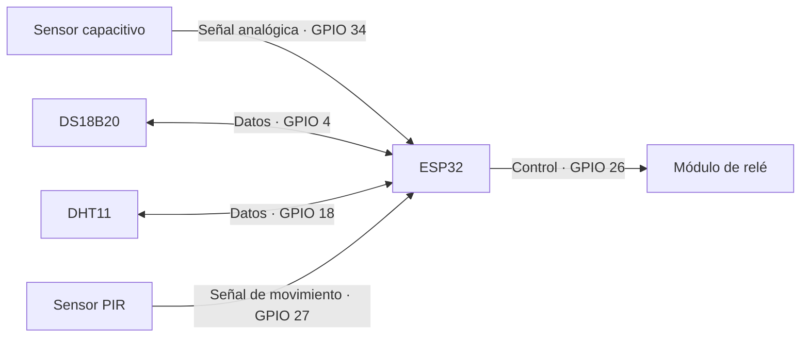

# Esquema de conexiones

El diagrama muestra los pines de señal configurados en el firmware del ESP32.

## Alimentación y tierra

- Sensor capacitivo: VCC a 3V3, tierra a GND y señal a GPIO 34.
- DS18B20: café = VCC, morado = datos y verde = GND.
- DHT11, PIR y módulo de relé: pendiente registrar cómo están
  conectados VCC y GND en el montaje.
- Pendiente confirmar la resistencia de datos del DS18B20 y qué
  entrada del módulo de relé se usa (IN1 o IN2).

## Estado de la prueba

Se comprobó la conmutación del relé. La prueba de bombeo queda pendiente.
